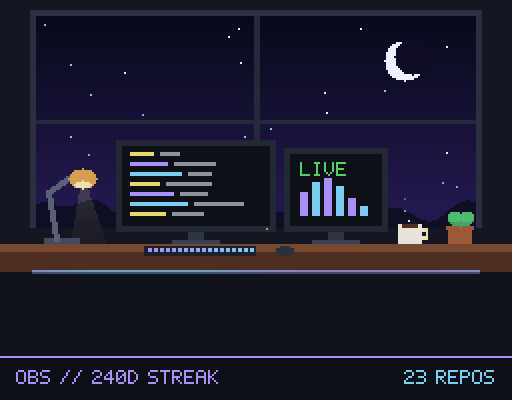
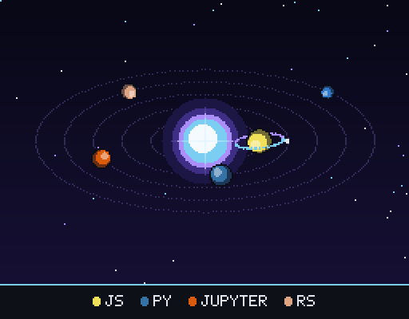
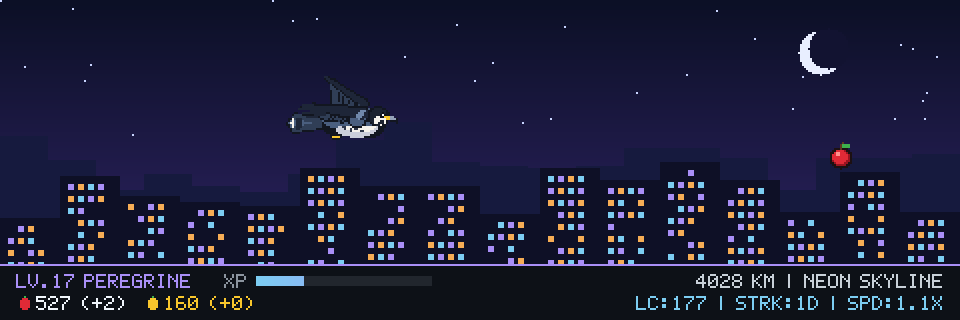

  

  

  
  
  
  
  

---

<!-- Living Ecosystem: Developer Observatory (Left), Cosmic Language Orbit (Right), and Rust Sky Falcon (Panoramic Stage) -->

  
  &nbsp;
  

 

  

  <i>🖥️ <b>Developer Observatory</b> live workspace &nbsp;&bull;&nbsp; 🪐 <b>Cosmic Language Orbit</b> top GitHub stack &nbsp;&bull;&nbsp; 🦅 <b>Sky Falcon</b> RPG fed by commits (🍎) &amp; LeetCode (⭐)</i>

---

### 📊 GitHub & Problem Solving Metrics

<a href="https://github.com/Srujan253#year-list-container">
  <picture>
    <source media="(prefers-color-scheme: dark)" srcset="cards/stats-dark.svg">
    
  </picture>
</a>
<a href="https://github.com/Srujan253?tab=repositories">
  <picture>
    <source media="(prefers-color-scheme: dark)" srcset="cards/languages-dark.svg">
    
  </picture>
</a>
 

 

  <a href="https://leetcode.com/SrujanHM/" target="_blank">
    <picture>
      <source media="(prefers-color-scheme: dark)" srcset="https://leetcard.jacoblin.cool/SrujanHM?theme=dark&font=baloo&ext=activity">
      
    </picture>
  </a>

 

  

---

### 🛠️ Tech Stack

| Domain | Stack & Core Focus |
| :--- | :--- |
| **💻 Frontend** |  HTML5, CSS3, ES6+, Responsive Design, React State & UI/UX |
| **⚙️ Backend & Data** |  Node.js, Express, REST APIs, JWT & Firebase Auth, MongoDB, MySQL |
| **📊 Data Science & ML** |  NumPy, Pandas, EDA, Matplotlib, Seaborn, Supervised & Unsupervised ML |
| **☁️ Cloud & DevOps** |  Git, GitHub Actions, Rust CLI, Postman, AWS, Azure, Vercel, Netlify |

---

### 🌟 Featured Projects

  <table>
    <tr>
      <td width="50%" align="center">
        <a href="https://github.com/Srujan253/gupshup">
          <picture>
            <source media="(prefers-color-scheme: dark)" srcset="https://github-readme-stats.vercel.app/api/pin/?username=Srujan253&repo=gupshup&bg_color=0d1117&title_color=a98ff7&text_color=c9d1d9&icon_color=7ccdf2&border_color=30363d" />
            
          </picture>
        </a>
         
        
      </td>
      <td width="50%" align="center">
        <a href="https://github.com/Srujan253/hack-bit">
          <picture>
            <source media="(prefers-color-scheme: dark)" srcset="https://github-readme-stats.vercel.app/api/pin/?username=Srujan253&repo=hack-bit&bg_color=0d1117&title_color=a98ff7&text_color=c9d1d9&icon_color=7ccdf2&border_color=30363d" />
            
          </picture>
        </a>
         
        
      </td>
    </tr>
    <tr>
      <td width="50%" align="center">
        <a href="https://github.com/Srujan253/CipherX">
          <picture>
            <source media="(prefers-color-scheme: dark)" srcset="https://github-readme-stats.vercel.app/api/pin/?username=Srujan253&repo=CipherX&bg_color=0d1117&title_color=a98ff7&text_color=c9d1d9&icon_color=7ccdf2&border_color=30363d" />
            
          </picture>
        </a>
         
        
      </td>
      <td width="50%" align="center">
        <a href="https://github.com/Srujan253/formhub">
          <picture>
            <source media="(prefers-color-scheme: dark)" srcset="https://github-readme-stats.vercel.app/api/pin/?username=Srujan253&repo=formhub&bg_color=0d1117&title_color=a98ff7&text_color=c9d1d9&icon_color=7ccdf2&border_color=30363d" />
            
          </picture>
        </a>
         
        
      </td>
    </tr>
  </table>

---

  

  

